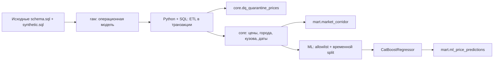

# Smart Logistics: ETL → PostgreSQL → ML

[](https://github.com/sofetizm/smart-logistics-de/actions/workflows/docker.yml)

Решение тестового задания Middle Data Engineer. Реализованы все три обязательных этапа: идемпотентная загрузка и карантин, карточка маршрута с рыночным коридором, хронологическое обучение CatBoost и пакетный скоринг в БД.

## Запуск одной командой

Требуются Docker Engine/Desktop и Docker Compose. Из корня проекта:

```bash
docker-compose up
```

Современный Compose также принимает `docker compose`; для пересборки образа добавьте `--build`. Ручное копирование `.env`, создание БД и запуск SQL не нужны. PostgreSQL 17 стартует первым; сервис `pipeline` генерирует 300 000 исходных сделок, создаёт слои, выполняет ETL, обучение, скоринг и проверку контрактов. Успешный результат — `pipeline exited with code 0` и JSON-события `etl_complete`, `ml_complete`, `verification`. Сервис БД продолжает работать для просмотра результатов.

Пароль создаётся случайно при первом старте и хранится в закрытом Docker volume `credentials`; паролей в исходниках нет. Данные PostgreSQL сохраняются в volume `pgdata`. Настройки можно изменить через `.env`, используя `.env.example`. Не удаляйте volume с паролем отдельно от данных БД.

Модель `.cbm`, метрики `metrics.json` и идентификатор модели появляются в `artifacts/`. Проверенные результаты и ограничения проверки приложены в `reports/VALIDATION.md`. [Docker-проверка прошла успешно](https://github.com/sofetizm/smart-logistics-de/actions/runs/42869799713): 37 тестов и повторный прогон без изменения данных.

## Архитектура и выбор инструментов



PostgreSQL 17 выполняет массовые преобразования, точные перцентили и хранит результаты. Python управляет транзакциями, параметрами, обучением и логированием. CatBoost работает с категориальной географией и кузовами без обучения отдельного энкодера. Вместо необязательного Airflow используется простой CLI с опцией периодического запуска: это сокращает инфраструктуру прототипа. Airflow, Superset и ClickHouse не входят в обязательную реализацию.

```text
etl/                 конфигурация, оркестрация ETL, CLI, проверки контрактов
ml/                  признаки, обучение, метрики и пакетный скоринг
sql/001_dwh.sql      физическая модель Core / Mart / Ops
sql/010_etl.sql      очистка, валюты, измерения, связи
sql/020_market_corridor.sql  эталонный SQL расчёта карточки
sql/030_ml_dataset.sql       одна строка на сделку для ML
sql/source/          исходные DDL и генератор без изменений
sql/examples.sql     готовые запросы для аналитика
reference/           исходные требования и продуктовые приложения
docker/Dockerfile    образ Python-конвейера
tests/               pytest и проверка повторного полного запуска
reports/             результаты выполненной проверки
```

## Этап 1. Очистка, валюты и повторные загрузки

Core хранит все прошедшие DQ строки: факты, торги, сложные маршруты, размеченные аномалии и будущие заявки. Бизнес-фильтры применяются отдельно в витринах и ML.

У строки может быть несколько причин DQ: невалидная цена, RUB `price <= 1000`, неположительная дистанция, отрицательные вес/объём, неизвестный город, неподдержанная валюта, отсутствующий/невалидный/неоднозначный курс. Дополнительно отклоняются `NaN` и бесконечности. Карантин содержит `price_id`, дату, массив кодов причин и исходную строку JSON. Сумма счётчиков причин может превышать число строк карантина.

Конвертация: RUB × 1; USD/EUR × точный курс `exchange_rates` на сохранённую `nearest_rate_date`. Новая дата курса по `loading_date` не вычисляется. `nearest_rate_date IS NULL` или отсутствие точной пары валюта/дата → карантин. В источнике поле определяется относительно `created_at`; так оно и сохраняется. Одинаковые дубликаты курса схлопываются, конфликтующие значения на одну дату дают `AMBIGUOUS_FX_RATE`. `price_rub` хранится как `numeric` без преждевременного округления, без добавления/вычитания НДС: исходный `price` уже без НДС.

Пропущенные/пустые категории заполняются: вес сначала округляется PostgreSQL до 0,1 т, затем используются границы 0,5 / 2,5 / 5 / 10 / 30 т; объём `FTL` при `0 < V <= 120`, иначе `OTH`. Существующие категории сохраняются. Одинаковые города отправления и назначения допустимы при положительной дистанции.

`outlier_mark` переносится как есть. **Свежие записи снимка за 2026-10-26 ещё не прошли ночную разметку и могут содержать неотмеченные выбросы.** Дополнительная статистическая чистка таргета не выполняется. Метрики и коридоры наследуют это ограничение источника.

Окно загрузки задаётся по `loading_date`, левая граница включена, правая исключена. По умолчанию обрабатывается вся история вместе с будущими заявками. Временная таблица IDs включает как текущие строки raw в окне, так и прежние строки Core/карантина в нём. Затем цены, карантин и связи этого набора атомарно заменяются. Это корректно обрабатывает повторный запуск, исправление брака, переход валидной строки в карантин, удаление источника и перенос даты сделки из обрабатываемого окна.

Все изменения Core и полное обновление рынка выполняются **в одной транзакции REPEATABLE READ**. Читатели видят предыдущую или новую согласованную версию. Advisory lock сериализует ETL/ML; при ошибке всё откатывается. Инициализация raw имеет отдельный lock и marker: повторное `init` пропускает генератор. Изменение `N_PRICES` не меняет уже созданный raw.

```bash
# Backfill за сентябрь, end-date не включается:
docker-compose run --rm pipeline python -m etl.run etl \
  --start-date 2026-09-01 --end-date 2026-10-01

# Повторный полный запуск, источник не генерируется заново:
docker-compose run --rm pipeline python -m etl.run all

# Только обучение/скоринг после изменения Core:
docker-compose run --rm pipeline python -m etl.run ml

# Проверка контрактов всей загруженной истории:
docker-compose run --rm pipeline python -m etl.run verify
```

Справочники перечитываются целиком. Изменения справочников, правил, валютных курсов, старых флагов и дочерних связей требуют backfill затронутых дат; для этого объёма предпочтителен полный запуск. Это оконная пакетная загрузка, не CDC по `updated_at`. Удаления вне выбранного окна обнаружатся при обработке соответствующего окна или полном запуске.

## Этап 2. Рыночный коридор

Город выбирается по минимальному `cities.id` на `gc_id`. Измерение Core имеет PK на `gc_id`, поэтому JOIN не размножает сделки. Регион — часть `full_name_local` после первой запятой с удалением пробелов; при отсутствии запятой — `UNKNOWN`.

Кузов: таблица `price_body_types` приоритетна; при отсутствии связей используется `prices.body_type`, затем `Не указан`. Коды приводятся к стандартным группам (`56/4/2/15`, остальные → `Прочие`), включая дочерние коды. PK связи `(price_id, body_group)` исключает повтор цены внутри группы. Сделка, подходящая к тенту и борту, участвует один раз в каждой группе. Поэтому **суммировать `trips_count` по разным кузовам как общее число рейсов нельзя**.

Даты сохраняются отдельной связью `(price_id, price_date)`. Месяц берётся именно из `price_dates`; внутри месяца дата/сделка дедуплицируется перед агрегацией. Долгосрочная заявка участвует в нескольких месяцах. Даты `price_date > as_of` отсекаются до агрегации.

Зерно `mart.market_corridor`:

`месяц × город отправления × город назначения × группа кузова × весовая категория`.

Объёмная категория в зерно не входит. Фильтр: `is_fact`, тип `1/2/3/4/5/9`, прямой маршрут, положительные цена/RUB/дистанция, `outlier_mark = false`. Расчёт включает P25/P50/P75 и среднее за рейс, P25/P50/P75 за км, уникальные сделки/перевозчиков, выборочный CV. Перевозчик считается только при типах `3/9`; `NULL` organization_id не считается.

MoM/YoY — JOIN на точный календарный месяц −1 / −12 при совпадении всех остальных ключей. Пропущенный месяц или нулевой знаменатель → `NULL`. `HIGH`: ≥30 сделок, ≥5 перевозчиков и последняя фактически использованная `price_date` не старше 30 дней относительно фиксированного `as_of`. При ≥10 сделках иначе `MEDIUM`, остальные `LOW_DATA`. Для одного наблюдения CV = `NULL`.

Витрина физическая, индексируется по PK и ключам маршрута. Полный пересчёт после оконного ETL намеренный: изменения старых цен влияют и на последующие MoM/YoY.

## Этап 3. ML без утечек

Дата снимка **2026-10-26**, не текущая дата компьютера:

| Выборка | Интервал `loading_date` |
|---|---|
| train | `[2026-07-26, 2026-10-05)` |
| test | `[2026-10-05, 2026-10-26]` |
| future | `> 2026-10-26` |

Train/test содержат только факты на прямых маршрутах без `outlier_mark`. Для future используются прошедшие DQ прямые заявки независимо от роли `price_type` и флага выброса; это плановые входы для прогноза, не фактический таргет. Будущие строки с непригодными ценами/географией остаются в карантине общего ETL. Для production нужно отдельно принимать заявки без заполненной цены; исходная схема задания требует `price NOT NULL`.

Признаки заданы явным allowlist в `ml/features.py`: расстояние, вес, объём, отдельные регионы/города и координаты отправления/назначения, кузов, весовая/объёмная категории, год, sin/cos месяца (12), дня недели (7), дня года (365,25). Отсчёт циклов с нуля. Несколько допустимых кузовов — одна отсортированная категориальная строка; **в ML одна сделка остаётся одним наблюдением**. Совпадающие дочерние кузова предварительно схлопнуты.

В признаки не попадают цена, цена/км, цена/тонна, НДС, маржа, organization_id, `price_group_id`, агрегаты `price_group_stats`, `outlier_mark`, валютные курсы или дата публикации тарифа. Категориальные пропуски заполняются постоянным `UNKNOWN`; числовые `NaN` обрабатывает CatBoost. Статистические импутеры, глобальные энкодеры и дополнительные пороги выбросов не обучаются.

Модель: `CatBoostRegressor`, RMSE, 600 деревьев, depth 7, learning_rate 0,06, CPU, seed `20261026`, два потока. Гиперпараметры фиксированы до теста. Тест не используется для early stopping, `eval_set` или подбора параметров; обучение завершается до чтения тестовых метрик. Разбиение без shuffle. После оценки модель не дообучается на test: те же веса используются для тестовых и будущих прогнозов. Базовый вариант не реализует исторические снимки справочников/постфактум-флагов, поэтому это проверка по фиксированному снимку, а не полностью point-in-time feature store.

R², MAPE (%), RMSE и MAE (руб.) выводятся в JSON-лог, файл и `mart.ml_models`. Идентификатор версии — хеш train-признаков/таргета/IDs, параметров, границ дат и версии feature pipeline. Прогнозы имеют PK `(model_id,price_id)`; обновление одной версии атомарно заменяет её набор. Разные версии сохраняются для сравнения. `scored_at` и журнал запусков меняются при повторе; бизнес-строки, суммы и прогнозы не задваиваются. Файлы модели записываются атомарным переименованием; при откате БД возможен неиспользуемый файл, но частичного набора прогнозов не будет.

В `mart.ml_price_predictions` записаны тестовые факты и future. Для future **всегда NULL** в `actual_price_rub`, `abs_error_rub`, `ape_pct`, даже при заполненной цене источника. APE = `abs(actual-predicted)/actual*100`. Нижний предел прогноза 0,01 руб. исключает отрицательные ставки; этот же предел применяется при расчёте метрик. Скоринг записывается параметризованными пакетами по 1000 строк, а не построчными INSERT.

### Полученные метрики на 300 000 исходных сделок

| Метрика test | Результат |
|---|---:|
| R² | 0,9209 |
| MAPE | 15,84% |
| RMSE | 53 815,15 руб. |
| MAE | 28 187,30 руб. |

Обучение: 24 226 сделок; test: 12 808; будущий скоринг: 5 820. Это измеренные результаты Docker-прогона на PostgreSQL 17.11 и CatBoost 1.2.8. Детали проверки — в `reports/VALIDATION.md`.
